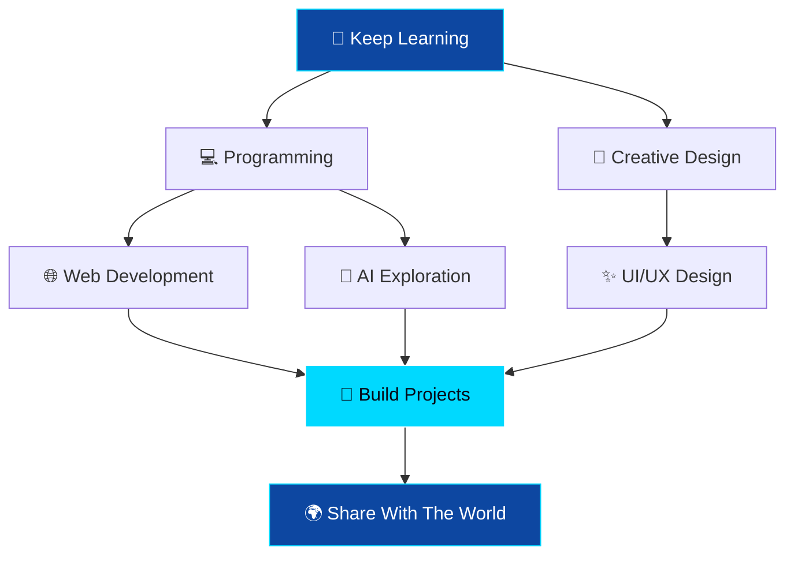

<!-- ═══════════════ ANIMATED HEADER ═══════════════ -->

 

---

<!-- ═══════════════ ABOUT ME ═══════════════ -->

## 👨‍💻 About Me

Hi! I'm **Reyyan Abbas**, a creative learner passionate about technology, coding, and digital creativity.

- 💻 Interested in web development and programming.
- 🎨 Exploring graphic design and creative projects.
- 🚀 Building websites and experimenting with new ideas.
- 📚 Always learning and improving my skills.
- 🌍 Interested in technology, AI, and digital innovation.
- 🎯 My goal is to build useful and creative digital products.
- 🤝 Open to learning, collaboration, and exciting projects.

 

---

## 🌐 Connect With Me

  

---

## 🛠️ Tech Stack & Tools

### 💻 Programming & Web Development

### ⚙️ Development Tools

### 🎨 Design & Creativity

<i>My interests and tools I'm exploring — proficiency varies by technology.</i>

---

## 🚀 My Projects

---

## 📊 GitHub Statistics

  

---

## 📈 GitHub Activity Graph

---

## 🐍 Contribution Snake

<picture>
  <source media="(prefers-color-scheme: dark)" srcset="https://raw.githubusercontent.com/reyyanking110/reyyanking110/output/github-contribution-grid-snake-dark.svg"/>
  <source media="(prefers-color-scheme: light)" srcset="https://raw.githubusercontent.com/reyyanking110/reyyanking110/output/github-contribution-grid-snake.svg"/>
  
</picture>

---

## 🎯 My Goals

| Goal | Mission |
|---|---|
| 💻 Development | Build useful and creative websites |
| 🤖 Artificial Intelligence | Explore AI tools and applications |
| 🎨 Design | Improve UI/UX and graphic design |
| 🌍 Open Source | Learn from and contribute to projects |
| 🚀 Innovation | Turn creative ideas into real products |

---

## 🗺️ My Learning Roadmap

---

## 💬 Developer Quote

---

## 🤝 Let's Build Something Amazing!

**Thanks for visiting my profile!** ⭐

If you like my work, consider following me on GitHub.

  

✨ Designed with passion by Reyyan Abbas | Keep Learning • Keep Building • Keep Growing ✨

