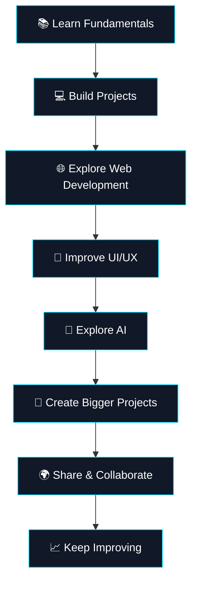

<div align="center">


<a href="https://github.com/reyyanking110">

</a>

<br/>


<br/><br/>

### `> Building the future, one line at a time.`

*Curious mind. Creative thinking. Continuous improvement.*

<br/>

<a href="https://github.com/reyyanking110">

</a>
<a href="https://reyyanabbas.vercel.app">

</a>
<a href="https://www.instagram.com/syed_reyyan_abbas110/">

</a>

</div>

---

## 👋 About Me

```yaml
name: Reyyan Abbas
github: reyyanking110
portfolio: reyyanabbas.vercel.app

roles:
  - Developer
  - Designer
  - Student
  - Creative Thinker

interests:
  - Web Development
  - Graphic Design
  - UI/UX Design
  - Artificial Intelligence
  - Digital Creativity
  - Technology

mindset: "Learn. Build. Improve. Repeat."
motto: "Dream big. Start small. Build consistently."
```

Hi there! 👋 I'm **Reyyan Abbas**, a student, developer, and designer passionate about technology, creativity, and building digital experiences.

I enjoy exploring new technologies, designing attractive interfaces, developing websites, and transforming ideas into real projects.

For me, development isn't just about writing code. It's about solving problems, experimenting with ideas, and continuously improving.

- 💻 Interested in development and programming.
- 🎨 Passionate about graphic design and creative visuals.
- 📚 Learning new concepts through study and practice.
- 🤖 Exploring AI-powered applications and modern technology.
- 🌐 Building websites and digital projects.
- 🎬 Interested in video content and digital creativity.
- 🚀 Focused on learning, creating, and improving every day.

> **My philosophy:** Stay curious, keep creating, and never stop learning.

---

## 🧭 What I Do

<table>
<tr>
<td width="33%" valign="top">

<h3 align="center">💻 Development</h3>

<p align="center">Building digital experiences through code.</p>

- Web development
- Programming fundamentals
- Website creation
- Problem-solving
- AI application exploration

</td>
<td width="33%" valign="top">

<h3 align="center">🎨 Design</h3>

<p align="center">Combining creativity with technology.</p>

- Graphic design
- UI/UX concepts
- Visual composition
- Branding and thumbnails
- Creative layouts

</td>
<td width="33%" valign="top">

<h3 align="center">📚 Learning</h3>

<p align="center">Growing through experimentation.</p>

- Academic learning
- New technologies
- Hands-on projects
- Creative thinking
- Continuous improvement

</td>
</tr>
</table>

---

## 🛠️ Tech Stack & Tools

### 🌐 Programming & Web Technologies

<div align="center">


</div>

### ⚙️ Development Tools

<div align="center">


</div>

### 🎨 Design & Creative Tools

<div align="center">


</div>

*These icons represent technologies and tools in my learning and creative interests; they don't imply expert-level proficiency in every tool.*

---

## 🚀 My Featured Projects

<div align="center">

### Explore My Digital Creations

*Websites and projects built with creativity, code, and passion.*

</div>

<table>
<tr>
<td width="50%" valign="top">

<h3>🌐 Personal Portfolio</h3>

<a href="https://reyyanabbas.vercel.app">

</a>

My personal website and digital identity.

**Platform:** Vercel

**Focus:** Personal branding and web presence.

</td>
<td width="50%" valign="top">

<h3>🚀 Project One</h3>

<a href="https://project1-taupe-psi.vercel.app/">

</a>

One of my featured web projects, showcasing my interest in building digital experiences.

**Platform:** Vercel

**Focus:** Web development.

</td>
</tr>
<tr>
<td width="50%" valign="top">

<h3>🎨 My Website</h3>

<a href="https://mywebsite-orcin-alpha.vercel.app/">

</a>

Another website from my collection of digital creations.

**Platform:** Vercel

**Focus:** Website design and development.

</td>
<td width="50%" valign="top">

<h3>💻 More on GitHub</h3>

<a href="https://github.com/reyyanking110?tab=repositories">

</a>

Explore my repositories to discover more projects, experiments, and future creations.

**Platform:** GitHub

**Focus:** Coding and continuous learning.

</td>
</tr>
</table>

---

## 📊 My GitHub Dashboard

<div align="center">

<a href="https://github.com/reyyanking110">

</a>

<a href="https://github.com/reyyanking110">

</a>

<br/><br/>


<br/><br/>


</div>

---

## 🎬 My YouTube Channels

<div align="center">

*Three channels. Different creative directions. One journey.*

</div>

<table>
<tr>
<td width="33%" align="center" valign="top">


### 🎙️ Voice of Shahnaz Abidi

A channel for sharing videos and creative content.

<a href="https://www.youtube.com/@voiceofshahnazabidi">

</a>

</td>
<td width="33%" align="center" valign="top">


### 🧠 Facter 700

A space for facts, videos, and interesting ideas.

<a href="https://youtube.com/@facter700">

</a>

</td>
<td width="33%" align="center" valign="top">


### ⚡ Its Ryan PK

A channel for my creative video projects and content.

<a href="https://youtube.com/@itsryanpk">

</a>

</td>
</tr>
</table>

---

## 📸 Instagram

<div align="center">


### @syed_reyyan_abbas110

Follow my Instagram profile to stay connected.

<a href="https://www.instagram.com/syed_reyyan_abbas110/">

</a>

</div>

---

## 🌍 My Digital Presence

<div align="center">

<a href="https://github.com/reyyanking110">

</a>
<a href="https://reyyanabbas.vercel.app">

</a>
<a href="https://project1-taupe-psi.vercel.app/">

</a>
<a href="https://mywebsite-orcin-alpha.vercel.app/">

</a>

<br/>

<a href="https://www.youtube.com/@voiceofshahnazabidi">

</a>
<a href="https://youtube.com/@facter700">

</a>
<a href="https://youtube.com/@itsryanpk">

</a>

<br/>

<a href="https://www.instagram.com/syed_reyyan_abbas110/">

</a>

</div>

---

## 🧠 My Developer Mindset

<div align="center">

| Principle | My Approach |
|:---|:---|
| 💡 Creativity | Think beyond the obvious |
| 🧩 Problem Solving | Break challenges into smaller steps |
| 📚 Learning | Improve a little every day |
| 🛠️ Building | Turn ideas into working projects |
| 🎯 Consistency | Keep moving forward |
| 🤝 Collaboration | Learn, share, and grow together |

</div>

---

## 🎯 My Current Goals

- [ ] Strengthen programming fundamentals.
- [ ] Build responsive websites and useful applications.
- [ ] Improve UI/UX and graphic design skills.
- [ ] Explore AI-powered development.
- [ ] Create more original projects.
- [ ] Improve code quality and documentation.
- [ ] Contribute to open-source projects.
- [ ] Build a strong developer portfolio.

---

## 🗺️ My Learning Roadmap



---

## 💬 A Few Things About Me

- 🔭 **Building:** Websites, digital projects, and coding experiments.
- 🌱 **Learning:** Development, design, and emerging technologies.
- 🎨 **Creating:** Visual designs and digital experiences.
- 🎬 **Exploring:** Video creation and online content.
- 🤝 **Interested in:** Collaboration and sharing knowledge.
- ⚡ **Fun fact:** I enjoy combining technology with creativity.
- 🧭 **Belief:** The best way to learn is to build something yourself.

---

## 🐍 Contribution Snake

<div align="center">


</div>

*To activate this animation, configure the GitHub Actions workflow using [Platane/snk](https://github.com/Platane/snk) to generate the SVG in the `output` branch.*

---

## ✨ My Philosophy

<div align="center">

### `Code with purpose. Design with passion. Learn without limits.`

Every project is an opportunity to learn something new.

Every challenge is a chance to improve.

Every idea can become something meaningful with curiosity, effort, and creativity.

### 🚀 This is just the beginning.

<br/>

<a href="https://github.com/reyyanking110?tab=repositories">

</a>

<br/><br/>


<sub>Designed with 💙 by Reyyan Abbas</sub>

<sub>Thanks for visiting my profile! ⭐</sub>

</div>
