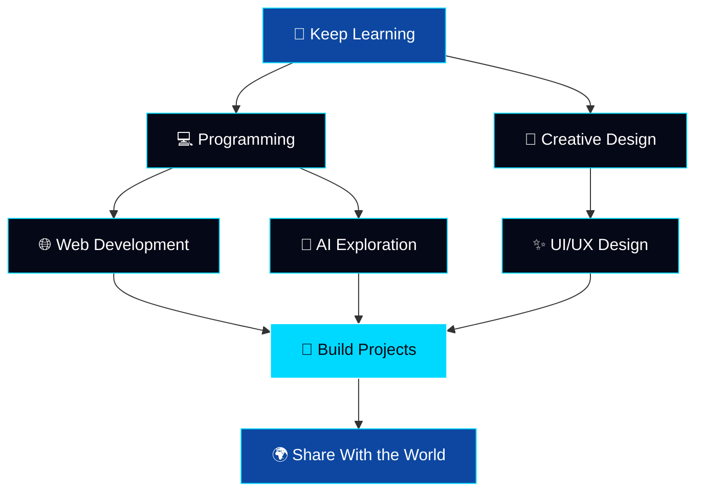

<!-- ═══════════ PIXEL GAME CINEMATIC INTRO ═══════════ -->

 

<table>
<tr>
<td align="center">

CREATIVITY

</td>
<td align="center">

EXPERIENCE

</td>
<td align="center">

DEVELOPER CLASS

</td>
</tr>
</table>

 

 

&nbsp;

  

<!-- ═══════════ END INTRO ═══════════ -->

<!-- ═══════════════════════ ABOUT ME ═══════════════════════ -->

## 👨‍💻 About Me

Hey there! 👋 I'm **Reyyan Abbas**, a creative learner exploring the world of programming, web development, digital design, and artificial intelligence.

I enjoy turning ideas into digital experiences and discovering how technology can solve real-world problems.

- 💻 Exploring programming and web development
- 🎨 Experimenting with digital design and creative interfaces
- 🚀 Building websites and personal projects
- 🤖 Exploring AI tools and emerging technologies
- 📚 Learning new skills one project at a time
- 🌍 Interested in open-source and developer communities
- ✨ **My philosophy:** Learn continuously, build consistently, improve constantly.

 

---

<!-- ═══════════════════════ CONNECT ═══════════════════════ -->

## 🌐 Connect With Me

  

<h2>🎬 My YouTube Channels</h2>

  

  

---

<!-- ═══════════════════════ TECH STACK ═══════════════════════ -->

## ⚡ Tech Stack & Tools

### 💻 Programming & Web Development

### 🧰 Developer Tools

### 🎨 Design & Creativity

 

<i>Technologies I use or am exploring. Proficiency varies by technology.</i>

---

<!-- ═══════════════════════ PROJECTS ═══════════════════════ -->

## 🚀 Projects & Experiments

<h2 align="center">🌐 My Web Development Projects</h2>

<table align="center">
<tr>
<td width="50%" align="center">

<h3>🚀 Personal Portfolio</h3>

  

A personal website showcasing my developer identity, skills, and work.

</td>
<td width="50%" align="center">

<h3>💻 Project One</h3>

  

A web project built to explore modern design and interactive web experiences.

</td>
</tr>
<tr>
<td width="50%" align="center">

<h3>✨ Project Two</h3>

  

Another website from my journey of learning, experimenting, and creating.

</td>
<td width="50%" align="center">

<h3>🧪 Future Projects</h3>

  

More creative websites, experiments, and exciting projects are on the way.

</td>
</tr>
</table>

---

<!-- ═══════════════════════ GITHUB ANALYTICS ═══════════════════════ -->

## 📊 GitHub Analytics

  

---

<!-- ═══════════════════════ ACTIVITY GRAPH ═══════════════════════ -->

## 📈 Contribution Activity

---

<!-- ═══════════════════════ CONTRIBUTION SNAKE ═══════════════════════ -->

## 🐍 Watch My Contributions Move!

<picture>
<source media="(prefers-color-scheme: dark)" srcset="https://raw.githubusercontent.com/reyyanking110/reyyanking110/output/github-contribution-grid-snake-dark.svg"/>
<source media="(prefers-color-scheme: light)" srcset="https://raw.githubusercontent.com/reyyanking110/reyyanking110/output/github-contribution-grid-snake.svg"/>

</picture>

 

---

<!-- ═══════════════════════ MINDSET ═══════════════════════ -->

## 🎯 My Developer Mindset

<table>
<tr>
<td align="center" width="33%">

 

  

<strong>Learn Continuously</strong>

 

Explore new ideas and technologies.

</td>
<td align="center" width="33%">

 

  

<strong>Build Creatively</strong>

 

Turn concepts into real projects.

</td>
<td align="center" width="33%">

 

  

<strong>Grow Consistently</strong>

 

Improve through practice.

</td>
</tr>
</table>

---

<!-- ═══════════════════════ GOALS ═══════════════════════ -->

## 🌟 Goals & Interests

| Focus | Mission |
|:---|:---|
| 💻 Web Development | Create useful and engaging websites |
| 🤖 Artificial Intelligence | Explore AI tools and applications |
| 🎨 UI/UX Design | Build clean and intuitive interfaces |
| 🌍 Open Source | Learn from the developer community |
| 🚀 Personal Projects | Turn ideas into practical experiences |

 

---

<!-- ═══════════════════════ LEARNING ROADMAP ═══════════════════════ -->

## 🗺️ My Learning Roadmap

---

<!-- ═══════════════════════ INSPIRATION ═══════════════════════ -->

## 💭 A Little Inspiration

  

---

<!-- ═══════════════════════ FOOTER ═══════════════════════ -->

  

  

Designed with 💙 by <strong>Reyyan Abbas</strong>

 

⚡ Keep Learning · 💻 Keep Building · 🚀 Keep Growing

