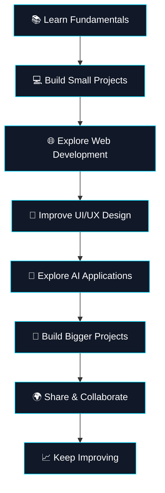

<!--
╔══════════════════════════════════════════════════════════╗
║            REYYAN ABBAS | GITHUB PROFILE                 ║
║       Developer • Designer • Student • Creator           ║
╚══════════════════════════════════════════════════════════╝
-->

<div align="center">

<!-- ANIMATED HEADER -->


<!-- TYPING ANIMATION -->
<a href="https://github.com/reyyanking110">
  
</a>

<br/>


<br/><br/>

### `> Building the future, one line at a time.`

*Curious mind. Creative thinking. Continuous improvement.*

<br/>

[](https://github.com/reyyanking110)
[](https://github.com/reyyanking110?tab=repositories)

</div>

---

<!-- ABOUT ME -->

## 🧑‍💻 About Me

```yaml
name: Reyyan Abbas
username: reyyanking110

roles:
  - Developer
  - Graphic & Digital Designer
  - Student
  - Creative Problem Solver

mindset: "Learn. Build. Improve. Repeat."

interests:
  - Software Development
  - Web Development
  - UI/UX Design
  - Artificial Intelligence
  - Creative Technology
  - Digital Content Creation

currently:
  - Improving my coding skills
  - Exploring modern web technologies
  - Designing creative digital experiences
  - Building projects and experimenting with AI

motto: "Dream big. Start small. Build consistently."
```

Hi there! 👋 I'm **Reyyan Abbas**, a student, developer, and designer passionate about technology, creativity, and turning ideas into reality.

I enjoy exploring how things work, designing visually appealing experiences, and building digital projects that combine functionality with creativity.

For me, development isn't just about writing code. It's about solving problems, experimenting with new ideas, and continuously improving the way things work.

- 💻 I enjoy building digital experiences.
- 🎨 I love creative design and visual storytelling.
- 📚 I'm a student who believes in learning by doing.
- 🤖 I'm interested in AI-powered applications and modern technology.
- 🚀 I enjoy experimenting with new tools, ideas, and workflows.
- 🌱 I'm always working to improve my skills.
- 🎯 My goal is to turn creative ideas into useful products.

**My philosophy:** Stay curious, keep creating, and never stop learning.

---

## 🧭 What I Do

<table>
<tr>
<td width="33%" valign="top">

<h3 align="center">💻 Development</h3>

<p align="center">
Building, experimenting, and learning how software works.
</p>

- 🌐 Web development
- 🧩 Programming fundamentals
- ⚙️ Logic and problem-solving
- 🤖 AI application concepts
- 🔧 Project development

</td>
<td width="33%" valign="top">

<h3 align="center">🎨 Design</h3>

<p align="center">
Creating modern, attractive, and meaningful visuals.
</p>

- 🖌️ Graphic design
- 📱 UI/UX concepts
- 🧱 Layout and composition
- 🖼️ Thumbnails and branding
- ✨ Visual creativity

</td>
<td width="33%" valign="top">

<h3 align="center">📚 Learning</h3>

<p align="center">
Developing knowledge through practice and experimentation.
</p>

- 📖 Academic learning
- 💡 Exploring new technologies
- 🛠️ Hands-on practice
- 🧠 Creative thinking
- 📈 Continuous improvement

</td>
</tr>
</table>

---

## 🛠️ Tech Stack & Tools

### 🌐 Languages & Web Technologies

<div align="center">


</div>

### ⚙️ Development Tools

<div align="center">


</div>

### 🎨 Design & Creative Tools

<div align="center">


</div>

> These icons represent technologies and tools in my learning and creative interests, not a claim of expert-level proficiency in every tool.

---

## 📊 My GitHub Dashboard

<div align="center">

<a href="https://github.com/reyyanking110">
  
</a>

<a href="https://github.com/reyyanking110">
  
</a>

<br/><br/>


<br/><br/>


</div>

---

## 🚀 Featured Projects

<div align="center">

<table>
<tr>
<td width="50%" valign="top">

### 🌐 Web Development

**Creative Websites & Web Experiences**

Developing web interfaces and experimenting with layouts, styling, and interactive features.

**Focus areas:**
- Responsive design
- HTML, CSS & JavaScript
- Clean user interfaces

<p>
<a href="https://github.com/reyyanking110?tab=repositories">

</a>
</p>

</td>
<td width="50%" valign="top">

### 🤖 AI & Innovation

**AI-Powered Applications**

Exploring how artificial intelligence can make applications smarter, more useful, and more interactive.

**Focus areas:**
- AI application concepts
- Chatbot experiences
- Creative automation

<p>
<a href="https://github.com/reyyanking110?tab=repositories">

</a>
</p>

</td>
</tr>
<tr>
<td width="50%" valign="top">

### 🎨 Graphic Design

**Visual Design & Branding**

Experimenting with creative visuals, digital branding, thumbnails, and modern graphic compositions.

**Focus areas:**
- Visual identity
- Social media graphics
- UI/UX inspiration

</td>
<td width="50%" valign="top">

### 📚 Learning Projects

**Learning Through Building**

Using small projects and experiments to strengthen programming knowledge and problem-solving skills.

**Focus areas:**
- Practice projects
- New technologies
- Continuous improvement

</td>
</tr>
</table>

</div>

> Replace these general project categories with your actual repository names and descriptions as your portfolio grows.

---

## 🧠 My Developer Mindset

<div align="center">

| Principle | What It Means to Me |
|:---|:---|
| 💡 Creativity | Think beyond the obvious |
| 🧩 Problem Solving | Break complex tasks into smaller steps |
| 📚 Learning | Improve a little every day |
| 🛠️ Building | Turn ideas into working projects |
| 🎯 Consistency | Keep moving forward |
| 🤝 Collaboration | Learn from other people and share ideas |

</div>

---

## 🎯 Current Goals

- [ ] Strengthen programming fundamentals.
- [ ] Build responsive websites and useful applications.
- [ ] Improve UI/UX and graphic design skills.
- [ ] Explore AI-powered development.
- [ ] Create a collection of original projects.
- [ ] Improve code quality and documentation.
- [ ] Contribute to open-source projects.
- [ ] Build a strong developer portfolio.

---

## 🗺️ My Learning Roadmap



---

## 💬 A Few Things About Me

- 🔭 **Building:** Creative digital projects and coding experiments.
- 🌱 **Learning:** Development, design, and emerging technologies.
- 🎨 **Creating:** Visual designs and digital experiences.
- 🤝 **Interested in:** Collaboration, knowledge sharing, and new ideas.
- ⚡ **Fun fact:** I enjoy combining technology with creativity.
- 🧭 **Belief:** The best way to learn is to build something yourself.

---

## 🌐 Connect With Me

<div align="center">

<a href="https://github.com/reyyanking110">
  
</a>

<!-- Add your real profile links when available. -->

<a href="https://www.linkedin.com/">
  
</a>

<a href="https://www.instagram.com/">
  
</a>

<br/><br/>

**Open to learning, creating, and collaborating on interesting ideas.**

</div>

---

## 🐍 Contribution Snake

<div align="center">

<!--
To enable this animation, configure the GitHub Actions workflow
described at:
https://github.com/Platane/snk

After configuring the workflow, use the generated SVG below.
-->


</div>

---

## ✨ The Philosophy

<div align="center">

### `Code with purpose. Design with passion. Learn without limits.`

I believe every project is an opportunity to learn something new.

Every challenge is a chance to improve.

Every idea can become something meaningful with enough curiosity, effort, and creativity.

**This is just the beginning. 🚀**

<br/>


<sub>Designed with 💙 by Reyyan Abbas</sub>

<sub>⭐ If you like what I'm building, explore my repositories and follow my journey.</sub>

</div>
